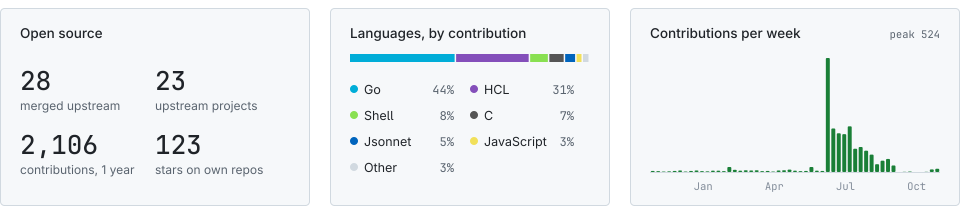

## Usman Malik, Kubernetes consultant and cloud native architect

I am Usman Malik, a Kubernetes consultant and cloud native architect with 15+ years in Linux, platform engineering and DevSecOps. I design and build private cloud and sovereign cloud platforms on bare metal Kubernetes for critical infrastructure operators and cloud providers. Virtual machines run next to containers, with KubeVirt, Proxmox VE and Cloud Hypervisor as open source alternatives to VMware. When a component breaks on the way, I fix it upstream as an open source contributor to Kubernetes, Talos Linux, OVN-Kubernetes and Ceph. My work also covers supply chain security with Sigstore, SLSA and SBOM, compliance for KRITIS, NIS2 and ISO 27001, and AI inference infrastructure on Kubernetes with vLLM, llm-d and DRA. I am available for 1:1 consulting.

[](https://www.immalik.com/) [](https://www.linkedin.com/in/imusmanmalik) [](https://x.com/iamusmanmalik) [](https://www.immalik.com/) 

```yaml
name: Usman Malik
role: Kubernetes consultant and cloud native architect
experience: 15+ years in Linux/UNIX, cloud native and security
now: Senior platform engineer for a sovereign European public cloud
before:
  - Lead core architect, compute and virtualization, European transmission system operator
  - Cloud native platform architect, edge cloud provider
  - Tech lead platform and tech lead IT security, fintech
focus:
  - Private and sovereign cloud on bare metal Kubernetes
  - Virtualization on Kubernetes and open source VMware alternatives
  - L3 data center networking with BGP to the host, EVPN-VXLAN and ECMP
  - Kubernetes operators and controllers that run at scale
  - Supply chain security and compliance for KRITIS, NIS2 and ISO 27001
  - Confidential computing with confidential VMs and confidential containers
  - AI inference infrastructure on Kubernetes
  - Upstream work in Kubernetes, Talos Linux, OVN-Kubernetes and Ceph
talks:
  - 10 minutes from bare metal to KubeVirt, ContainerDays 2023
education: MSc Digital Investigation and Forensic Computing, University College Dublin
certifications:
  - CKS
  - CKA
  - CKAD
  - LFCE
  - LFCS
  - RHCE
community:
  - Red Hat Accelerator, 2023 to now
  - OpenTofu manifesto signatory
fun_fact: "I read RFCs, kernel changelogs and CVE feeds for fun."
```

<picture>
  <source media="(prefers-color-scheme: dark)" srcset="assets/racks-dark.svg">
  
</picture>

Open the diagram full size in [light](assets/racks-light.svg) or [dark](assets/racks-dark.svg) mode.

## How I work

- Product requirements and the roadmap come first, then the tools. A tool stays when it pays off for the business, the team can run it for years, and it fits the cost and energy budget. The stack in this README is what I use today, and it changes as the requirements change.
- Ownership runs from day 0 design through day 1 rollout to day 2 operations. Day 2 is where most of the work is, with upgrades, incidents, capacity planning and cost.
- Leading the architecture means writing the code for it too. That includes Kubernetes operators and controllers that run at scale, the pull requests that go with them, and the on-call rotation after the release.
- Inside the team, I write design docs with the engineers, agree on trade-offs with the product owners, and review code like any other team member.
- Security and observability go into the first design, because adding them later costs more. I have done bug bounty work and studied digital forensics, so I design with both the attacker and the incident responder in mind. Every component ships with its metrics, logs, traces and alerts.

## Open source contributions to Kubernetes, KubeVirt, Talos Linux and Ceph

The diagram is the platform I build. Each marker in it is a pull request in this table.

| Rack | Component | What changed | State |
| :-- | :-- | :-- | :-- |
| **A** control plane | Kubernetes control plane | [Taint eviction reports deletion latency in seconds](https://github.com/kubernetes/kubernetes/pull/141742) | <kbd>merged</kbd> |
|  | Kubernetes control plane | [Scheduler volumebinding no longer panics](https://github.com/kubernetes/kubernetes/pull/143949) when a CSIStorageCapacity has no capacity | <kbd>in review</kbd> |
|  | Bare metal provisioning | [Worker replica count can be set](https://github.com/spectrocloud-public/cluster-api-provider-maas/pull/121) in the Cluster API MAAS provider | <kbd>in review</kbd> |
|  | GitOps | [kapp-controller default sync period is configurable](https://github.com/carvel-dev/kapp-controller/pull/1259) | <kbd>merged</kbd> |
| **B** compute | GPU inference and batch | [DRA device taint eviction no longer counts terminating pods](https://github.com/kubernetes/kubernetes/pull/143790) | <kbd>merged</kbd> |
|  | VMs and microVMs | [Bug report](https://github.com/kubevirt/kubevirt/issues/19782) and [fix](https://github.com/kubevirt/kubevirt/pull/19783) for a KubeVirt live migration that fails on the way back to its source node | <kbd>in review</kbd> |
|  | Node agent | [kubelet FileKeyRef parsing](https://github.com/kubernetes/kubernetes/pull/142665) handles optional files, empty values and whitespace | <kbd>merged</kbd> |
|  | Node agent | [kubelet uses the last definition of a duplicated key in env files](https://github.com/kubernetes/kubernetes/pull/143947) | <kbd>in review</kbd> |
|  | Node agent | [Kubernetes docs for env file syntax and optional FileKeyRef](https://github.com/kubernetes/website/pull/59013) | <kbd>in review</kbd> |
|  | Pod network | [OVN-Kubernetes UDN host isolation degrades instead of failing node startup](https://github.com/ovn-kubernetes/ovn-kubernetes/pull/6735). The kubelet cgroup path is configurable, so it runs on hosts without systemd such as Talos | <kbd>merged</kbd> |
|  | BGP to the host | [bird2 starts in Talos maintenance mode](https://github.com/siderolabs/extensions/pull/1067), so a BGP-to-host node gets its address before the container runtime runs | <kbd>merged</kbd> |
|  | Immutable OS | [yip partition growth no longer mixes sectors and bytes](https://github.com/mudler/yip/pull/257) on Kairos nodes | <kbd>merged</kbd> |
|  | Immutable OS | [kairos-init tries the epel-release package first on RHEL](https://github.com/kairos-io/kairos-init/pull/327) | <kbd>merged</kbd> |
|  | Immutable OS | [kairos-init drops python3-pynvim from Debian base packages](https://github.com/kairos-io/kairos-init/pull/150) | <kbd>merged</kbd> |
|  | Linux kernel | Talos kernel builds with [`CONFIG_XFRM_INTERFACE`](https://github.com/siderolabs/pkgs/pull/1663) for route-based IPsec | <kbd>merged</kbd> |
|  | Linux kernel | Talos kernel builds with [`CONFIG_NFT_SOCKET`](https://github.com/siderolabs/pkgs/pull/1625) for socket matching in nftables | <kbd>merged</kbd> |
|  | Linux kernel | [xfrm uses software GSO for inner tunnels](https://lore.kernel.org/netdev/?q=%22use+software+GSO+for+inner+tunnels%22) when the device has no crypto offload | <kbd>posted to netdev</kbd> |
| **C** storage | Ceph | [ceph-csi Helm chart passes `POD_NAMESPACE`](https://github.com/ceph/ceph-csi/pull/5722), so the KMIP secret lookup for volume encryption finds its secret | <kbd>merged</kbd> |

## Platform engineering stack, from bare metal Kubernetes to AI inference

These are the tools I reach for today. The requirement picks the tool, so the list keeps moving.

- Bare metal cloud with Metal3, Ironic, Cluster API, MAAS, Tinkerbell and Redfish.
- Sovereign cloud building blocks from NeoNephos, including the IronCore metal-operator, and Cozystack for European digital sovereignty.
- Host operating systems such as Talos Linux, Kairos, Flatcar, bootc, Red Hat Enterprise Linux, Ubuntu and SUSE, down to the Linux kernel with eBPF, nftables and IPsec/XFRM.
- Virtualization, microVMs and VMware alternatives with KubeVirt, Proxmox VE, Incus, Cloud Hypervisor, Firecracker, Flintlock, KVM, Kata Containers and Forklift.
- Data center networking with BGP to the host, unnumbered BGP, ECMP, EVPN/VXLAN, BIRD and FRR, from underlay to overlay design.
- Load balancers and API gateways, from HAProxy, Envoy, LoxiLB, MetalLB and Katran to Gateway API with Envoy Gateway, kgateway, Kong, Traefik, APISIX and Emissary-ingress.
- Kubernetes and operators with DRA, Kueue, kubebuilder, controller-runtime, OVN-Kubernetes, kube-ovn, Cilium and Multus.
- Multi-cluster and fleets with Karmada, Clusternet, k0smotron, k0rdent, Kamaji, Rancher, Fleet and Cluster API.
- Zero trust networking with Istio, Linkerd, Cilium service mesh, Kuma and Kmesh, using mTLS and SPIFFE/SPIRE workload identity.
- Identity and access through Keycloak, Authentik, Authelia, Teleport, OpenZiti and SpiceDB.
- Storage and databases on Ceph, Rook, LINSTOR, Garage, SeaweedFS, CloudNativePG, TimescaleDB, Redis, Valkey and Velero.
- Streaming and messaging on Kafka, NATS, Redpanda, Pulsar and RabbitMQ.
- GitOps and platform engineering with Argo CD, Flux, kro, Carvel, Crossplane, OpenTofu and Backstage, fed by Git and OCI registry mirrors such as GitLab and Harbor.
- CI/CD pipelines in GitHub Actions, GitLab CI, Jenkins, Tekton and Earthly.
- Supply chain security with Sigstore, Cosign, SLSA, in-toto attestations, SBOMs from Syft, Trivy, Kyverno, OPA Gatekeeper, SOPS and OWASP practices.
- Runtime security and confidential computing with Falco, Tetragon, eBPF profiling and gVisor, confidential VMs on AMD SEV-SNP and Intel TDX, Confidential Containers, Kata Containers and Constellation, plus secrets in HashiCorp Vault and OpenBao.
- Compliance work for KRITIS, NIS2, ISO 27001 and BSI IT-Grundschutz.
- Observability with OpenTelemetry, Prometheus, VictoriaMetrics, Mimir, Grafana, Loki, Tempo, Jaeger, Pyroscope, Fluent Bit, Fluentd, Vector and Perses.
- Chaos engineering and resilience tests with Chaos Mesh, LitmusChaos and Chaos Toolkit.
- AI inference infrastructure with vLLM, llm-d, KServe, the Gateway API Inference Extension, the NVIDIA GPU Operator, DRA for GPUs on Kubernetes and MCP.
- Public cloud on AWS, Azure, GCP, OVHcloud, Hetzner and Equinix Metal, next to private cloud.

I write Go, Rust, Python and Bash.

## Security research and forensics

I hold an MSc in Digital Investigation and Forensic Computing and the CKS certification. I have done bug bounty work, penetration tests and threat modeling, and I was tech lead IT security at a fintech.

```bash
$ whoami --security

Architect            # private cloud and platforms for critical infrastructure
Bug Bounty Hunter    # responsible disclosure across web and infra targets
Pentester            # network, host, cloud, container and Kubernetes hardening
Digital Forensics    # incident response, container and host forensics, eDiscovery
Threat Modeling      # STRIDE, attack surface mapping, zero trust architectures
DevSecOps Engineer   # shift-left CI/CD with SAST, DAST, secret and IaC scanning,
                     # image signing (Sigstore, Cosign), SLSA provenance, SBOM (CycloneDX, SPDX),
                     # admission control (Kyverno, OPA Gatekeeper), runtime (Falco, Tetragon)
Compliance           # ISO 27001, VDS 3473, BSI IT-Grundschutz, NIS2, KRITIS,
                     # ISMS lead, audit prep, risk assessments, SoA, control mapping
```

## Open source I maintain

| Project | Use it when | What you get |
| :-- | :-- | :-- |
| [cloudnative-pg-timescaledb-postgis-containers](https://github.com/imusmanmalik/cloudnative-pg-timescaledb-postgis-containers) | A CloudNativePG cluster needs TimescaleDB and PostGIS in one image | Operand images for each Postgres major, smoke-tested in CI. 70 stars |
| [cert-manager-mixin](https://github.com/imusmanmalik/cert-manager-mixin) | You run cert-manager and monitor with Prometheus | Alerts and Grafana dashboards, listed on [monitoring.mixins.dev](https://monitoring.mixins.dev/cert-manager/). 18 stars |
| [randomizer](https://github.com/imusmanmalik/randomizer) | Go code needs random values from `crypto/rand` | A small Go library. 33 stars |

## Activity

<picture>
  <source media="(prefers-color-scheme: dark)" srcset="assets/stats-dark.svg">
  
</picture>

<picture>
  <source media="(prefers-color-scheme: dark)" srcset="https://raw.githubusercontent.com/imusmanmalik/imusmanmalik/output/snake-dark.svg">
  <source media="(prefers-color-scheme: light)" srcset="https://raw.githubusercontent.com/imusmanmalik/imusmanmalik/output/snake.svg">
  
</picture>

## Kubernetes consulting for private and sovereign cloud

I take 1:1 consulting on bare metal Kubernetes, KubeVirt and VMware exits, sovereign cloud architecture and platform security under NIS2 and KRITIS. Send the problem in two lines through [immalik.com](https://www.immalik.com/) or [LinkedIn](https://www.linkedin.com/in/imusmanmalik).

If my open source work helps you, you can [sponsor it on GitHub](https://github.com/sponsors/imusmanmalik).
